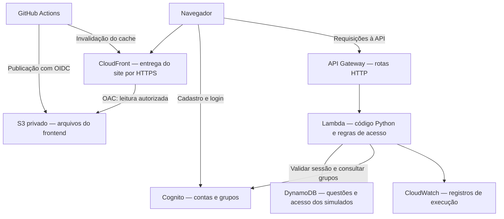

# SimulaCloud — aprendendo DevOps na AWS

O SimulaCloud é uma plataforma de simulados para a certificação AWS Certified Cloud Practitioner (CLF-C02). Este repositório também funciona como um laboratório: você pode acompanhar uma mudança desde o código no Git até a aplicação publicada na AWS.

Este guia explica o que cada etapa faz, como executá-la e como conferir o resultado. Os exemplos usam **Bash no Linux ou no WSL**, o ambiente Linux executado dentro do Windows.

## Roteiro de aprendizado

1. [Entender a arquitetura](#1-entender-a-arquitetura)
2. [Localizar os arquivos](#2-localizar-os-arquivos)
3. [Preparar o terminal e a conta AWS](#3-preparar-o-terminal-e-a-conta-aws)
4. [Entender o estado do Terraform](#4-entender-o-estado-do-terraform)
5. [Configurar e aplicar a infraestrutura](#5-configurar-e-aplicar-a-infraestrutura)
6. [Executar e validar localmente](#6-executar-e-validar-localmente)
7. [Entender o GitHub Actions](#7-entender-o-github-actions)
8. [Configurar e acompanhar a publicação](#8-configurar-e-acompanhar-a-publicação)
9. [Administrar os perfis no Cognito](#9-administrar-os-perfis-no-cognito)
10. [Testar a aplicação publicada](#10-testar-a-aplicação-publicada)
11. [Consultar logs e investigar problemas](#11-consultar-logs-e-investigar-problemas)
12. [Repetir o fluxo nas próximas mudanças](#12-repetir-o-fluxo-nas-próximas-mudanças)
13. [Cuidar dos custos e dos dados](#13-cuidar-dos-custos-e-dos-dados)
14. [Evoluir o laboratório](#14-evoluir-o-laboratório)

## 1. Entender a arquitetura

DevOps aproxima desenvolvimento e operação: além de escrever a funcionalidade, precisamos conseguir publicá-la, verificar seu funcionamento e corrigir problemas de forma repetível.

A aplicação é **serverless**: a AWS gerencia os servidores que executam os serviços. Continuamos responsáveis pelo código, pelas permissões, pelos dados e pela configuração desses serviços.



| Componente | Papel no projeto | O que você aprende |
| --- | --- | --- |
| React + Vite | Geram a interface e os arquivos de produção | Separar desenvolvimento local de publicação |
| S3 | Armazena HTML, CSS e JavaScript em um bucket privado | Hospedar arquivos estáticos e controlar o acesso |
| CloudFront | Entrega arquivos por HTTPS e mantém cópias em cache | Distribuição de conteúdo e atualização de cache |
| API Gateway | Recebe chamadas como `GET /simulados` | Expor uma API HTTP |
| Lambda | Executa o backend Python quando a API é chamada | Publicar código sem administrar uma máquina virtual |
| DynamoDB | Guarda questões e configurações de acesso | Persistência de dados separada da aplicação |
| Cognito | Gerencia cadastro, login e grupos | Autenticação e perfis de usuário |
| IAM | Define o que cada identidade AWS pode fazer | Conceder permissões conforme a tarefa |
| CloudWatch | Armazena registros de execução da Lambda | Investigar o comportamento da aplicação |
| Terraform | Descreve e atualiza a infraestrutura em arquivos `.tf` | Infraestrutura como código, ou IaC |
| GitHub Actions | Executa os workflows do repositório | Validação e publicação automatizadas |

O **OAC**, ou controle de acesso à origem, permite que a distribuição CloudFront leia os arquivos do bucket privado. O **cache** guarda cópias desses arquivos para acelerar sua entrega.

**Há duas entregas diferentes:** o frontend é publicado pelo GitHub Actions; a infraestrutura e o código da Lambda são atualizados pelo Terraform, executado manualmente neste estágio do projeto.

## 2. Localizar os arquivos

```text
SimulaCloud/                         # Raiz do repositório e dos comandos Terraform
├── .github/workflows/
│   ├── deploy-frontend.yml          # Compila e publica o frontend
│   └── terraform-check.yml          # Valida a configuração Terraform
├── lambda/lambda_function.py        # Backend e regras de acesso
├── tests/test_permissions.py        # Testes locais das permissões
├── simulacloud-frontend/frontend/
│   ├── src/                        # Código React
│   ├── .env.example                # Modelo de configuração local do login
│   ├── package.json                # Dependências e comandos npm
│   ├── package-lock.json           # Versões usadas na instalação com npm ci
│   └── dist/                       # Arquivos gerados pelo build
├── main.tf                         # DynamoDB, Lambda, API Gateway, IAM e logs
├── frontend.tf                     # S3, CloudFront e acesso OIDC do GitHub
├── cognito.tf                      # Contas, app client e grupos
├── variables.tf                    # Entradas e valores padrão da infraestrutura
├── outputs.tf                      # Valores consultáveis após a implantação
├── providers.tf                    # Configuração do provedor AWS
├── version.tf                      # Restrições de versão do Terraform e provedores
├── data.tf                         # Empacotamento da Lambda e dados da conta AWS
├── .terraform.lock.hcl             # Versões selecionadas dos provedores
└── populate_db.py                  # Importação opcional de questões
```

A pasta `aws/`, presente no repositório, contém arquivos de uma distribuição da AWS CLI. Ela não é o código da infraestrutura; os recursos são descritos nos arquivos `.tf` da raiz.

## 3. Preparar o terminal e a conta AWS

### Entrar na pasta correta

No WSL, o disco `C:` aparece como `/mnt/c`. Use:

```bash
cd /mnt/c/Estudos/Devops/simula/SimulaCloud
pwd
```

O `pwd` mostra a pasta atual. Se você clonou o repositório em outro local, adapte o caminho. No PowerShell, o caminho equivalente é `C:\Estudos\Devops\simula\SimulaCloud`; os demais exemplos deste guia continuam sendo para Bash.

### Conferir as ferramentas

```bash
git --version
terraform version
aws --version
node --version
npm --version
python3 --version
```

| Ferramenta | Uso aqui |
| --- | --- |
| Git | Revisar, versionar e enviar mudanças ao GitHub |
| Terraform | Preparar, planejar e aplicar a infraestrutura |
| AWS CLI | Consultar a conta, administrar grupos e ler logs |
| Node.js 22 + npm | Instalar dependências e compilar o frontend, como no workflow |
| Python 3 | Executar os testes; o runtime padrão da Lambda é Python 3.12 |

O `version.tf` aceita Terraform a partir de `1.5.0`. O workflow de validação fixa `1.12.2`. Usar essa mesma versão localmente ajuda a reproduzir a execução da automação. As versões selecionadas dos provedores ficam em `.terraform.lock.hcl`, que deve continuar versionado.

Se um comando não for encontrado, instale a ferramenta no ambiente em que você está trabalhando. Uma instalação no Windows não garante que o comando esteja disponível no Linux do WSL.

### Confirmar a identidade AWS

Use as credenciais ou o perfil AWS configurados para seu laboratório e execute:

```bash
aws sts get-caller-identity
```

A resposta mostra `Account`, `Arn` e `UserId`. Confira a conta antes de aplicar mudanças. Estar autenticado não garante permissão para criar todos os recursos.

**Identidade AWS e conta do site são diferentes:** o usuário ou role usado pelo terminal administra recursos AWS; o usuário Cognito entra no SimulaCloud. Ser Admin no site não concede acesso administrativo à conta AWS.

## 4. Entender o estado do Terraform

O Terraform usa um arquivo chamado **state**, normalmente `terraform.tfstate`, para associar os recursos do código aos recursos existentes na AWS. Pense nele como o registro de quais recursos esta implantação administra.

**O backend atual é local.** O state fica na máquina onde o Terraform foi executado, não no GitHub. Clonar o código em outra máquina não recupera automaticamente esse arquivo.

Se a infraestrutura já existe, preserve e proteja o state e seu backup. Não execute uma nova implantação com state vazio sobre o mesmo ambiente: o Terraform pode tentar criar recursos que já existem. Recupere o state correto antes de continuar.

| Arquivo | Vai para o Git? | Motivo |
| --- | --- | --- |
| Código `.tf` e `.terraform.lock.hcl` | Sim | Descrevem a infraestrutura e as dependências selecionadas |
| `terraform.tfvars` | Não | Configuração local; pode incluir valores privados |
| `terraform.tfstate` e backups | Não | Contêm o estado e podem incluir dados sensíveis |
| `*.tfplan` | Não | Plano salvo que pode conter dados sensíveis |
| `.terraform/` | Não | Cache e arquivos locais de inicialização |
| `lambda_function.zip` | Não | Pacote gerado a partir do código Python |

O `.gitignore` já ignora esses padrões. **Um plano chamado apenas `tfplan` não corresponde a `*.tfplan`**: se você o criou durante o laboratório, não o inclua no commit. Use nomes como `infra.tfplan` nas próximas execuções ou adicione `/tfplan` ao `.gitignore`.

Mantenha um backup protegido do state fora do Git. Para trabalho em equipe, uma evolução necessária será migrar esse estado para um backend remoto com controle de acesso e bloqueio de execuções concorrentes.

## 5. Configurar e aplicar a infraestrutura

Execute esta seção na raiz do repositório. Quem já tem a infraestrutura funcionando usa o mesmo fluxo para atualizar recursos, preservando o state existente.

### Revisar as variáveis

O arquivo `variables.tf` define, entre outros, estes valores:

| Variável | Padrão | Significado |
| --- | --- | --- |
| `aws_region` | `us-east-1` | Região da maior parte dos recursos |
| `project_name` | `simulado-aws` | Prefixo dos nomes dos recursos |
| `environment` | `dev` | Identificação do ambiente |
| `lambda_runtime` | `python3.12` | Versão do Python na Lambda |
| `lambda_memory` | `256` | Memória da Lambda em MB |
| `lambda_timeout` | `10` | Tempo máximo de uma execução, em segundos |
| `github_oidc_subjects` | Sem padrão | Identidades GitHub autorizadas a assumir a role de publicação |

Para uma instalação nova, crie um `terraform.tfvars` local. Se ele já existe, revise-o em vez de sobrescrevê-lo. Exemplo para este repositório:

```hcl
aws_region   = "us-east-1"
project_name = "simulado-aws"
environment  = "dev"

github_oidc_subjects = [
  "repo:PHEvers/SimulaCloud:ref:refs/heads/main",
  "repo:PHEvers@113642670/SimulaCloud@1387502457:ref:refs/heads/main"
]
```

O **subject OIDC** identifica a origem da execução autorizada. Os exemplos representam os formatos por nome e com IDs imutáveis deste repositório, restritos à branch `main`. O valor precisa corresponder ao subject emitido pelo GitHub para a execução.

A validação atual em `variables.tf` está limitada a `PHEvers/SimulaCloud`. Se você usar um fork, adapte também essa validação e os subjects ao seu próprio repositório. Alterar somente o `tfvars` não basta.

Alterar `environment` não cria, por si só, isolamento de state entre ambientes. Não troque `dev` por `prod` no mesmo state como exercício de criação de um segundo ambiente.

### Inicializar e validar

Execute um comando por vez; se houver falha, resolva antes de avançar:

```bash
terraform init
terraform fmt -check
terraform validate
```

- `init` prepara o diretório e instala os provedores. Não cria os recursos AWS.
- `fmt -check` confere a formatação. Se apontar arquivos, execute `terraform fmt`, revise a diferença com `git diff` e repita a conferência.
- `validate` verifica a estrutura da configuração. Não testa as permissões reais da conta nem garante que o deploy terá sucesso.

### Gerar e interpretar o plano

```bash
terraform plan -out=infra.tfplan
```

O plano compara a configuração, o state e as informações consultadas na AWS. Ele mostra as alterações previstas sem aplicá-las. O provedor Archive também pode gerar o ZIP local da Lambda nessa preparação.

| Símbolo no plano | Significado |
| --- | --- |
| `+ create` | Criar um recurso |
| `~ update in-place` | Atualizar o recurso existente |
| `- destroy` | Excluir um recurso |
| `-/+` ou `+/-` | Substituir um recurso, envolvendo criação e exclusão |

Um resumo como `Plan: 5 to add, 3 to change, 0 to destroy` significa cinco criações, três atualizações e nenhuma exclusão. Ainda assim, leia quais recursos serão alterados: uma atualização de permissões pode mudar quem tem acesso, mesmo sem excluir nada.

Para reler o arquivo salvo:

```bash
terraform show infra.tfplan
```

### Aplicar o plano revisado

**O comando seguinte altera a conta AWS e pode gerar custos.** Ao fornecer um plano salvo, o Terraform começa a aplicação sem pedir uma nova confirmação.

```bash
terraform apply infra.tfplan
```

Se o código ou as variáveis mudarem depois do planejamento, gere e revise um novo plano antes de aplicar. Se o Terraform informar que o plano ficou desatualizado, repita o planejamento.

O resultado esperado é `Apply complete!`, seguido dos recursos criados, atualizados e excluídos. O CloudFront pode levar mais tempo para concluir a atualização.

### Consultar os resultados

```bash
terraform output
terraform output -raw frontend_url
```

Os **outputs** são valores úteis para operar o ambiente. O primeiro comando lista todos; o segundo retorna somente a URL do site, sem aspas. Criar a infraestrutura disponibiliza os serviços; os arquivos do frontend são enviados na etapa de publicação.

Se houver erro indicando que o provedor OIDC do GitHub já existe na conta, não tente criar outro nem exclua o existente. Verifique quem o administra; se ele deve pertencer a este state, avalie sua importação para o Terraform.

## 6. Executar e validar localmente

### Configurar o frontend

Na raiz do repositório, consulte:

```bash
terraform output -raw cognito_user_pool_id
terraform output -raw cognito_app_client_id
terraform output -raw api_url
```

Depois entre na pasta do frontend:

```bash
cd simulacloud-frontend/frontend
```

Se ainda não existir um `.env.local`, copie o modelo:

```bash
cp .env.example .env.local
```

Edite `.env.local` com os valores reais dos outputs. Os valores abaixo são exemplos para substituir:

```dotenv
VITE_COGNITO_USER_POOL_ID=us-east-1_SEU_POOL
VITE_COGNITO_APP_CLIENT_ID=SEU_APP_CLIENT_ID
VITE_API_URL=https://SUA_API.execute-api.us-east-1.amazonaws.com
```

Use a URL base da API, sem acrescentar `/questions`. Se `VITE_API_URL` não for definida, o código usa a URL do ambiente original como alternativa. Configure-a explicitamente ao usar outra implantação.

**As variáveis `VITE_` ficam incorporadas ao JavaScript entregue ao navegador.** IDs públicos do Cognito e URL da API podem estar nelas; senhas, chaves AWS e client secrets não podem. O app client deste projeto não usa segredo.

### Instalar, executar e compilar

```bash
npm ci
npm run dev
```

O `npm ci` instala as versões registradas no `package-lock.json`. O `npm run dev` inicia o servidor de desenvolvimento; abra a URL exibida no terminal. Use `Ctrl+C` para encerrá-lo.

O frontend local chama a API AWS configurada; ele não inicia uma Lambda ou um DynamoDB local. Criar questões por essa interface grava no ambiente configurado.

Para conferir a compilação de produção:

```bash
npm run build
```

O **build** transforma o código em arquivos estáticos na pasta `dist/`. Compilar localmente não publica esses arquivos na AWS. Se alterar `.env.local`, reinicie o servidor local ou gere um novo build.

Volte à raiz:

```bash
cd ../..
```

### Executar os testes de permissões

```bash
python3 -m unittest discover -s tests -v
```

Os testes usam serviços AWS simulados e a biblioteca padrão do Python. Conferem a matriz de acesso, a consulta direta a uma questão restrita e as permissões de criação, exclusão e configuração. O resultado esperado é terminar com `OK`.

Eles não chamam a AWS nem verificam a autenticação Cognito real. Por isso, também fazemos testes na aplicação publicada. Os testes Python ainda não são executados pelos workflows atuais.

## 7. Entender o GitHub Actions

**CI**, ou integração contínua, executa verificações quando o código muda. **CD**, neste projeto, é a publicação automática do frontend. Cada arquivo YAML em `.github/workflows/` descreve um workflow, ou sequência de trabalhos.

| Campo do YAML | Como ler |
| --- | --- |
| `on` | Quando executar: push, pull request ou acionamento manual |
| `paths` | Quais arquivos alterados disparam a execução |
| `permissions` | Permissões do token da execução no GitHub |
| `jobs` | Trabalhos a executar |
| `runs-on` | Ambiente da máquina que executará o trabalho, chamada runner |
| `steps` | Etapas executadas em sequência dentro do trabalho |
| `uses` | Uma ação reutilizável, como instalar o Node.js |
| `run` | Um comando de terminal |
| `env` | Variáveis de ambiente disponíveis para os comandos |

### Workflow de validação do Terraform

Arquivo: [terraform-check.yml](.github/workflows/terraform-check.yml).

Executa em pull requests e em pushes na `main` que alterem arquivos `.tf`, `.terraform.lock.hcl` ou o próprio workflow. Também aceita acionamento manual.

Ele baixa o código, instala Terraform `1.12.2`, executa `terraform init -backend=false -input=false` e depois `terraform validate`.

O `-backend=false` permite inicializar os provedores para validação sem inicializar um backend remoto; `-input=false` evita perguntas interativas. Esse workflow não executa `plan`, `apply`, `fmt -check` nem os testes Python. Não precisa de credenciais AWS para essas etapas de validação.

### Workflow de publicação do frontend

Arquivo: [deploy-frontend.yml](.github/workflows/deploy-frontend.yml).

Executa após push na `main` quando há alterações em `simulacloud-frontend/frontend/**` ou no próprio workflow. Também aceita acionamento manual com `workflow_dispatch`.

A sequência é:

1. Baixar o código e preparar Node.js 22.
2. Conferir as seis variáveis exigidas para publicar.
3. Executar `npm ci` e `npm run build`.
4. Obter credenciais temporárias AWS usando OIDC.
5. Sincronizar o conteúdo de `dist/` com o bucket S3.
6. Solicitar a invalidação do cache do CloudFront.

O comando de sincronização usa `--delete`: arquivos do destino ausentes no build são removidos. O bucket deve ser dedicado ao frontend. O workflow solicita a invalidação, mas não espera sua conclusão; o navegador também pode manter cache local.

**As automações são independentes.** Atualmente, a publicação do frontend não depende do resultado do workflow Terraform. Um push somente no README não dispara nenhuma delas pelos filtros de arquivos.

### Por que usar OIDC?

OIDC permite que o GitHub apresente uma identidade à AWS e assuma uma **role**, que é um conjunto de permissões usado temporariamente. Assim, o workflow não guarda uma chave AWS permanente no repositório.

Há duas partes para isso funcionar:

- A política de confiança da role define **quem pode assumi-la**: o repositório e a branch autorizados pelo subject OIDC.
- A política de permissões define **o que ela pode fazer**: operar os arquivos do bucket do frontend e invalidar a distribuição CloudFront configurada.

No workflow, `contents: read` permite ler o repositório e `id-token: write` permite solicitar o token OIDC. A role de publicação não possui, por esta configuração, permissões para aplicar toda a infraestrutura Terraform.

## 8. Configurar e acompanhar a publicação

### Cadastrar as variáveis no GitHub

Abra o repositório em **Settings → Secrets and variables → Actions → Variables** e crie as variáveis de repositório abaixo. Consulte os valores com `terraform output` na máquina que mantém o state.

| Variável no GitHub | Output do Terraform |
| --- | --- |
| `AWS_ROLE_ARN` | `github_deploy_role_arn` |
| `AWS_REGION` | `frontend_aws_region` |
| `S3_BUCKET` | `frontend_bucket_name` |
| `CLOUDFRONT_DISTRIBUTION_ID` | `cloudfront_distribution_id` |
| `COGNITO_USER_POOL_ID` | `cognito_user_pool_id` |
| `COGNITO_APP_CLIENT_ID` | `cognito_app_client_id` |

Esses valores são identificadores, não chaves de acesso. O workflow os lê usando `${{ vars.NOME }}`; cadastrá-los apenas como Secrets não atende a essas referências.

O workflow repassa os IDs do Cognito para o build como `VITE_COGNITO_USER_POOL_ID` e `VITE_COGNITO_APP_CLIENT_ID`. **Ele ainda não repassa `VITE_API_URL`.** Para outra implantação, adicione esse mapeamento ao `env` do job, por exemplo `VITE_API_URL: ${{ vars.API_URL }}`, e cadastre `API_URL` com o output `api_url`.

Variáveis locais do WSL e o arquivo `.env.local` da sua máquina não são enviados automaticamente para o runner do GitHub.

### Acompanhar a execução

No GitHub, abra **Actions → Deploy do frontend** e selecione a execução do seu commit. Cada etapa deve terminar com sucesso. Se falhar, abra a primeira etapa com erro e leia a mensagem.

Para publicar manualmente o código já enviado, use **Run workflow**, escolha `main` e confirme a execução. Isso usa o código da branch selecionada, não arquivos ainda sem commit no seu computador.

Depois da publicação:

```bash
terraform output -raw frontend_url
```

Abra a URL retornada. O acesso deve ser pelo CloudFront: o bucket S3 permanece privado. Alterar uma variável de build no GitHub exige uma nova publicação para o site recebê-la.

## 9. Administrar os perfis no Cognito

**Autenticação** responde quem é a pessoa; **autorização** define o que ela pode fazer depois de identificada.

| Perfil | Público | Para cadastrados | Exclusivo do Admin | Criar questões | Configurar acesso e excluir questões |
| --- | --- | --- | --- | --- | --- |
| Visitante | Sim | Não | Não | Não | Não |
| Básico | Sim | Sim | Não | Não | Não |
| Colaborador | Sim | Sim | Não | Sim, nos simulados aos quais tem acesso | Não |
| Admin | Sim | Sim | Sim | Sim | Sim |

Os grupos no Cognito são exatamente `Admin`, `Colaborador` e `Basico`, sem acento. Contas autenticadas sem grupo são tratadas como Básico; o cadastro não adiciona automaticamente a conta ao grupo `Basico`. Se houver mais de um grupo, Admin tem prioridade sobre Colaborador.

A configuração inicial é A público, B para cadastrados e C exclusivo do Admin. O Admin pode alterá-la na página **Simulados**, e a mudança fica no DynamoDB. B e C começam sem questões. Questões antigas sem `simuladoId` pertencem ao A.

### Adicionar uma conta a um grupo

Primeiro, crie e confirme a conta pelo site. Na raiz do repositório, defina os valores para os próximos comandos:

```bash
PROJECT_REGION="$(terraform output -raw frontend_aws_region)"
USER_POOL_ID="$(terraform output -raw cognito_user_pool_id)"

aws cognito-idp list-users \
  --region "$PROJECT_REGION" \
  --user-pool-id "$USER_POOL_ID" \
  --query 'Users[].{Username:Username,Email:Attributes[?Name==`email`].Value|[0]}' \
  --output table
```

Localize o e-mail e copie o `Username` correspondente. Ele pode ser um identificador longo, diferente do e-mail. Substitua o exemplo antes de executar:

```bash
COGNITO_USERNAME='SUBSTITUA_PELO_USERNAME_ENCONTRADO'

aws cognito-idp admin-add-user-to-group \
  --region "$PROJECT_REGION" \
  --user-pool-id "$USER_POOL_ID" \
  --username "$COGNITO_USERNAME" \
  --group-name Admin
```

Esse comando muda o acesso da conta. Para outro perfil, use `Colaborador` ou `Basico`. Em caso de sucesso, é normal não aparecer saída. Confira:

```bash
aws cognito-idp admin-list-groups-for-user \
  --region "$PROJECT_REGION" \
  --user-pool-id "$USER_POOL_ID" \
  --username "$COGNITO_USERNAME" \
  --query 'Groups[].GroupName' \
  --output table
```

Adicionar um grupo não remove os anteriores. Para retirar privilégios de Admin, remova o grupo `Admin` com `admin-remove-user-from-group`, usando os mesmos parâmetros; adicionar apenas `Basico` não reduz esses privilégios.

Saia e entre no site após alterar grupos para renovar os dados da interface. O servidor consulta os grupos nas chamadas autenticadas. Essas associações são operadas pela AWS CLI; os recursos Terraform atuais criam os grupos, mas não gerenciam seus membros.

## 10. Testar a aplicação publicada

Um **teste de fumaça** é uma verificação curta das funções essenciais depois de publicar. Na raiz do projeto, consulte a API por meio dos outputs, sem copiar IDs de outro ambiente:

```bash
API_URL="$(terraform output -raw api_url)"
```

### Listagem pública

```bash
curl -i "$API_URL/simulados"
```

O `-i` mostra os cabeçalhos e o código HTTP. Na configuração inicial, esperamos `200` e somente o simulado A. Se o Admin mudou os acessos, a lista deve refletir os simulados atualmente públicos.

### Acesso restrito sem login

```bash
curl -i "$API_URL/questions?simulado=B"
```

Se B continua para cadastrados, esperamos `403`. Isso confirma o bloqueio para visitantes. Coloque a URL entre aspas para o shell não interpretar seus caracteres como comandos.

### Tentativa de criação sem login

```bash
curl -i -X POST "$API_URL/questions" \
  -H 'Content-Type: application/json' \
  -d '{}'
```

Esperamos `403`, sem cadastro de questão. No Bash, a barra `\` continua o comando na linha seguinte e precisa ser o último caractere da linha.

| Código HTTP | Como interpretar neste projeto |
| --- | --- |
| `200` | Consulta ou operação concluída |
| `201` | Questão criada |
| `400` | Dados enviados inválidos |
| `401` | Sessão inválida ou expirada |
| `403` | Acesso negado |
| `404` | Rota, questão ou simulado não encontrado |
| `500` | Falha interna que precisa ser investigada |

As rotas do API Gateway não têm um autorizador próprio configurado. A Lambda valida o token de acesso Cognito e decide o acesso, permitindo que as mesmas rotas também atendam visitantes. Ocultar um botão na interface, sozinho, não protegeria uma rota.

### Conferência pelo navegador

Teste uma sessão sem login e contas de cada perfil. O Admin deve ver A, B e C e o controle de acesso; Colaborador deve conseguir criar questões nos simulados permitidos; Básico não deve ter essa opção. Um simulado sem questões deve informar essa condição.

O teste de bloqueio sem login não comprova todo o fluxo autenticado: confira também cadastro, confirmação de e-mail, login e renovação da sessão após uma mudança de grupo.

## 11. Consultar logs e investigar problemas

Os **logs** são registros de execução. A configuração cria um grupo no CloudWatch para a Lambda com retenção de sete dias.

Na raiz do projeto, consulte os registros recentes:

```bash
PROJECT_REGION="$(terraform output -raw frontend_aws_region)"
FUNCTION_ARN="$(terraform output -raw lambda_arn)"
FUNCTION_NAME="${FUNCTION_ARN##*:}"

aws logs tail "/aws/lambda/$FUNCTION_NAME" \
  --region "$PROJECT_REGION" \
  --since 15m
```

`--since 15m` limita a consulta aos últimos quinze minutos. A expressão `${FUNCTION_ARN##*:}` extrai o nome da função do ARN retornado pelo Terraform. Se adicionar `--follow`, o comando acompanha novos registros; encerre com `Ctrl+C`.

A implementação atual devolve uma mensagem genérica em erros internos e não registra o detalhe de todas as exceções tratadas. Os logs da plataforma ajudam a encontrar timeouts e falhas de execução, mas melhorar os registros da aplicação é uma etapa futura.

| Sintoma | Primeira investigação |
| --- | --- |
| `cd` não reconhece um caminho `C:\...` | No WSL, use `/mnt/c/...` |
| `terraform fmt -check` aponta arquivos | Rode `terraform fmt`, revise o diff e repita a verificação |
| `plan` pede `github_oidc_subjects` | Confira o `terraform.tfvars` local; ele não vem do Git |
| AWS CLI retorna `AccessDenied` | Confirme a identidade e a permissão necessária para a operação |
| Workflow informa variáveis ausentes | Confira os seis nomes em Actions → Variables |
| Falha em `AssumeRoleWithWebIdentity` | Confira ARN, subject, branch e confiança OIDC da role |
| Falha em `npm ci` | Confira o log e a consistência entre `package.json` e `package-lock.json` |
| Login aparece como não configurado | Confira os IDs `VITE_COGNITO_*` no ambiente do build e publique novamente |
| Perfil não muda após associação ao grupo | Confirme os grupos e saia e entre novamente |
| Site mostra a versão anterior | Confira o commit publicado, a etapa de invalidação e o cache do navegador |
| API retorna `403` | Confira perfil e acesso do simulado; pode ser o bloqueio esperado |
| API retorna `500` | Confira logs, permissões da Lambda e variáveis `TABLE_NAME`, `USER_POOL_ID` e `USER_POOL_CLIENT_ID` |
| Workflow não começou após um push | Confira branch e filtros `paths`; somente README não dispara os atuais |

## 12. Repetir o fluxo nas próximas mudanças

Antes de publicar, identifique o que mudou:

| Mudança | Como verificar | Como entregar |
| --- | --- | --- |
| Interface React | `npm ci` e `npm run build` na pasta do frontend | Push na `main` dispara a publicação do frontend |
| Código em `lambda/` | Testes Python na raiz | Revisar `terraform plan` e aplicar; o ZIP da Lambda é atualizado |
| Arquivos `.tf` | `fmt -check`, `validate` e revisão do plano | Workflow valida; `apply` continua manual |
| Membros de grupos Cognito | Consultar os grupos e testar nova sessão | AWS CLI ou console; sem recompilar o site |
| Variáveis usadas no build | Conferir configuração do job | Executar novamente a publicação do frontend |
| README | Revisar o texto e os comandos | Commit e push; sem necessidade de implantação |

Para mudanças que dependem de novas rotas ou serviços, aplique e verifique o backend antes de publicar a interface que depende dele. Como os workflows atuais são independentes, planeje essa ordem antes de enviar tudo à `main`.

### Revisar e versionar

```bash
git status --short
git diff --stat
git diff
```

`M` indica arquivo modificado; `??` indica arquivo novo ainda não acompanhado pelo Git. Revise os arquivos e adicione somente os desejados. Para publicar uma alteração neste documento:

```bash
git add readme.md
git diff --cached
git commit -m "docs: atualizar guia DevOps do projeto"
git push origin main
```

O `git diff --cached` mostra exatamente o que entrará no commit. O push envia código ao repositório; a implantação depende dos gatilhos descritos nos workflows.

Ao alternar Windows e WSL, diferenças entre quebras de linha CRLF e LF podem inflar o diff. `git diff --ignore-space-at-eol` ajuda a identificar a diferença real. Uma evolução do repositório é padronizar essas regras em `.gitattributes`.

### Recuperar uma versão com problema

Para o frontend, uma opção é reverter o commit responsável, revisar o resultado e enviar a reversão à `main`, gerando uma nova publicação. Confira que a reversão continua compatível com o backend atual.

Na infraestrutura e na Lambda, reverter o código no Git não altera a AWS por si só. Gere um novo plano com o código corrigido, revise o impacto e aplique. A reversão de código não recupera dados excluídos.

## 13. Cuidar dos custos e dos dados

Serverless não significa custo zero. Há uso de armazenamento, requisições, execução, logs e transferência de dados. Acompanhe os gastos na conta AWS e configure um orçamento para o laboratório.

O DynamoDB usa cobrança sob demanda; a API atual faz varreduras da tabela para carregar questões. Isso atende ao laboratório, mas precisa ser revisto conforme o volume de dados e acessos crescer.

O comando `terraform destroy` exclui recursos gerenciados pelo state. Não o use como uma limpeza rotineira: ele pode remover a tabela com questões e configurações, contas Cognito e outros recursos. Um bucket S3 com arquivos também pode impedir sua exclusão. Antes de encerrar o laboratório, planeje o backup e revise um plano de destruição com a mesma atenção usada na implantação.

Para adicionar questões, prefira o formulário do site com perfil Admin ou Colaborador. Há também um importador opcional para um arquivo JSON fornecido pelo operador, usando `boto3` e credenciais AWS com permissão na tabela:

```bash
python3 populate_db.py caminho/para/questoes.json NOME_DA_TABELA
```

Essa importação direta pode substituir itens com o mesmo `id`; não use o prefixo reservado `SIMULADO#` nos IDs de questões. O script também possui um modo HTTP, mas ele ainda não envia o token de autenticação exigido pela API atual. Esse modo precisa ser adaptado antes de uso.

## 14. Evoluir o laboratório

O projeto já permite praticar Git, infraestrutura como código, autenticação de workflows com OIDC, publicação em S3/CloudFront e verificação de acesso na API.

Os próximos exercícios podem ser feitos nesta ordem:

1. **Organizar o repositório:** deixar de versionar arquivos gerados, dependências instaladas e a distribuição da AWS CLI. Há arquivos em `dist/` e `node_modules/` ainda acompanhados pelo Git; adicionar um padrão ao `.gitignore` não remove o que já está versionado.
2. **Ampliar a CI:** executar os testes Python, a compilação do frontend e a conferência de formatação em pull requests antes da publicação.
3. **Proteger a entrega:** trabalhar com branches e pull requests e configurar verificações obrigatórias antes de integrar à `main`.
4. **Migrar o state:** adotar backend remoto com acesso restrito, versionamento e bloqueio para permitir colaboração.
5. **Separar ambientes:** usar configurações e estados independentes para desenvolvimento e produção.
6. **Melhorar a operação:** registrar erros de forma útil, criar alarmes e testar procedimentos de recuperação.
7. **Automatizar a infraestrutura:** somente depois das etapas anteriores, planejar `plan` e `apply` em CI/CD com permissões e aprovação adequadas.

### Limites atuais da aplicação

O fluxo de estudo oferece cinco questões por etapa, confirmação da resposta, explicação e resultado acumulado. Os simulados dependem das questões cadastradas no DynamoDB. Histórico e respostas não são persistidos entre sessões.

O backend retorna o gabarito ao frontend para o fluxo de estudo; a aplicação não foi projetada como uma plataforma de provas com sigilo das respostas. O catálogo atual contém os IDs A, B e C; o Admin configura seu acesso, mas não cria novos IDs pela interface.

O SimulaCloud é um projeto de estudo e portfólio, independente e sem vínculo, patrocínio ou endosso da Amazon Web Services.
